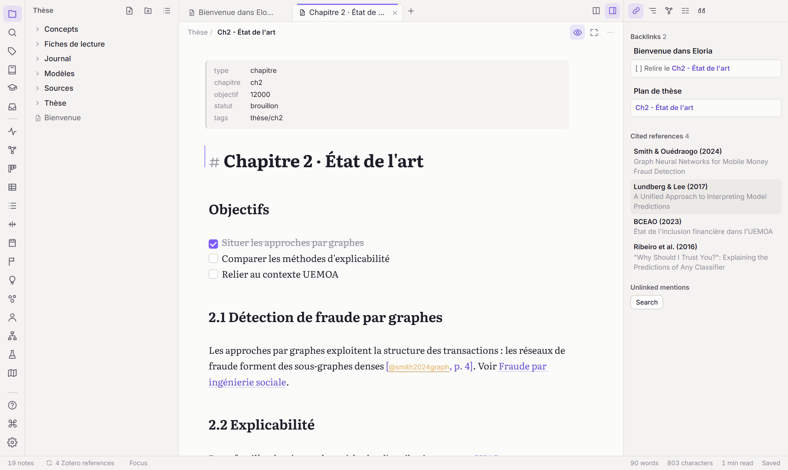
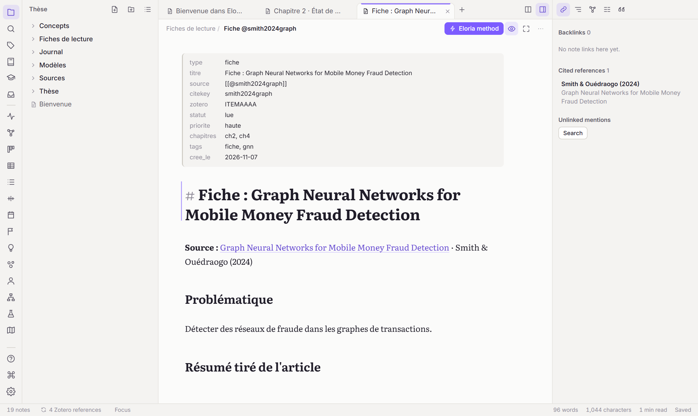
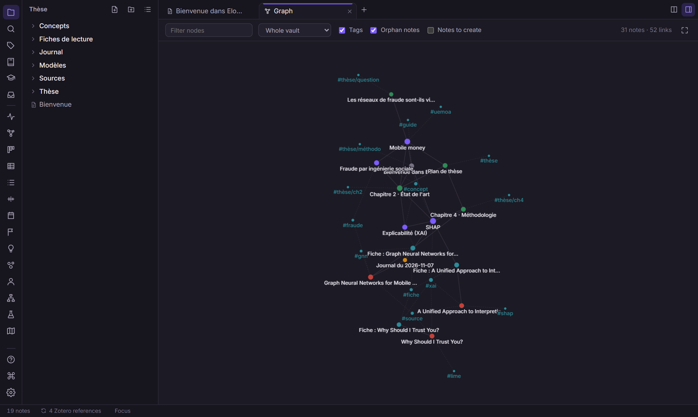
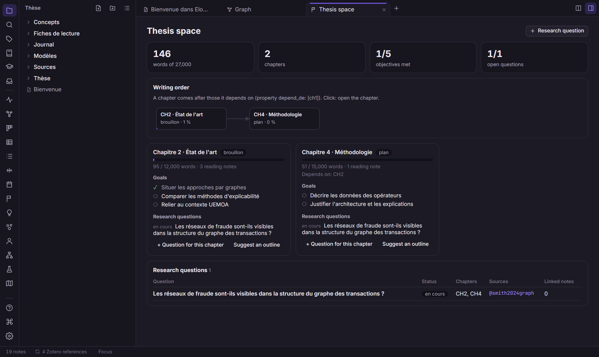

<p align="center"></p>

<h1 align="center">ELORIA</h1>
<p align="center"><b>Your knowledge, beautifully connected.</b><br>A personal workspace for research, writing and knowledge.</p>

<p align="center">
  <a href="https://github.com/a-dera/eloria/releases/latest">Download</a> ·
  <a href="docs/user-guide.md">User guide</a> ·
  <a href="docs/zotero.md">Zotero</a> ·
  <a href="docs/extensions.md">Extensions</a> ·
  <a href="CONTRIBUTING.md">Contributing</a>
</p>

---

Eloria is a desktop app for reading, annotating, linking notes and writing a thesis on top of your **Zotero** library. Notes are plain Markdown (and LaTeX) files in a folder, your *vault*, compatible with Obsidian. Everything works offline; AI and online services are optional.

- **Write**: Markdown with live preview, editable tables, note embeds, math, Mermaid diagrams; a LaTeX editor with local compilation and SyncTeX; Markdown to LaTeX conversion and thesis assembly.
- **Read**: a read-only mirror of your Zotero library (Eloria never writes to Zotero), references added by DOI, title, PDF or BibTeX, a built-in PDF reader with annotations, reading notes, a research matrix, literature reviews, source reliability signals.
- **Connect**: links and backlinks, graph, concepts, topics, entities, a personal taxonomy, a knowledge map and a thesis workspace.
- **Optional AI**: ask questions to your notes, generate reading notes, rewrite and summarise. Every reference cited by the AI must exist in your vault or library; anything else is removed or flagged.
- **Make it yours**: themes, shortcuts, typed properties, saved views, custom commands, JavaScript extensions, an MCP server for AI assistants.

The interface is available in **English** and **French**.






## Download

Installers for Windows (x64 and ARM64), macOS (Apple Silicon and Intel) and Linux (`.deb`, `.rpm`, `.AppImage`) are on the [releases page](https://github.com/a-dera/eloria/releases/latest).

The installers are not code-signed yet:

- **Windows**: SmartScreen may warn on first launch; choose *More info › Run anyway*.
- **macOS**: right-click the app and choose *Open* the first time, or run `xattr -dr com.apple.quarantine /Applications/Eloria.app`.

See [docs/installation.md](docs/installation.md) for details and for building from source.

## Quick start (from source)

```bash
npm install
npm run app        # run Eloria in development mode
npm run dev        # interface only, in the browser, with a mock backend and a demo vault
npm run bundle     # build the installers for the current platform
```

Prerequisites: Rust (stable), Node.js 20+, and the [Tauri system dependencies](https://v2.tauri.app/start/prerequisites/) for your platform.

## Documentation

|                                     |                                                                                   |
| ----------------------------------- | --------------------------------------------------------------------------------- |
| [Installation](docs/installation.md) | Install, build from source, where data is stored                                  |
| [User guide](docs/user-guide.md)     | Writing, views, templates, shortcuts (the in-app help, `F1`, covers everything) |
| [Zotero](docs/zotero.md)             | Library mirror, reading notes, citations, bibliography                            |
| [Extensions](docs/extensions.md)     | Writing an extension, developer console                                           |
| [Contributing](CONTRIBUTING.md)      | Architecture, tests, conventions, releases                                        |
| [Changelog](CHANGELOG.md)            | Version history                                                                   |

## Privacy

Your notes stay on your computer. Nothing is sent anywhere unless you use an online feature yourself (metadata lookup, AI). API keys are stored in the operating system's credential store, never in files. See [SECURITY.md](SECURITY.md).

## Built with

Rust, [Tauri 2](https://tauri.app), Svelte 5, CodeMirror 6, SQLite (FTS5), PDF.js, KaTeX, Mermaid.

## License

[MIT](LICENSE) © 2026 Amédée DERA.
