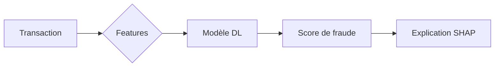

# Bienvenue dans Eloria

Eloria est un éditeur **Markdown** pensé pour la recherche : tes notes restent de simples fichiers `.md`, reliés entre eux et à ta bibliothèque Zotero.

> [!astuce] Raccourcis essentiels
> `Ctrl+P` palette de commandes · `Ctrl+O` ouvrir une note · `Ctrl+N` nouvelle note · `Ctrl+G` graphe · `Ctrl+,` réglages

## Relier ses idées

Tape `[[` pour créer un lien : [[Plan de thèse]], [[SHAP]] ou [[Mobile money|l'argent mobile]]. Un lien vers une note qui n'existe pas encore, comme [[Idée à creuser]], la crée au clic.

Les tags s'écrivent #guide ou #thèse/méthodo et apparaissent dans le panneau Tags et dans le graphe.

## Citer Zotero

Tape `[@` pour insérer une citation : comme le montrent [@smith2024graph, p. 4] et [@lundberg2017unified]. Le panneau **Zotero** (barre de gauche) crée les fiches de lecture.

## Mettre en forme

Du texte en *italique*, en **gras**, ==surligné==, ~~barré~~ et du `code`.

- [x] Importer ma bibliothèque Zotero
- [ ] Rédiger la fiche de [@ribeiro2016why]
- [ ] Relire le [[Ch2 - État de l'art]]

| Méthode | Type | Locale |
| --- | --- | --- |
| SHAP | Attribution | Oui |
| LIME | Substitut | Oui |
| Attention | Interne | Partielle |

## Formules

La valeur de Shapley d'une variable $i$ :

$$
\phi_i = \sum_{S \subseteq F \setminus \{i\}} \frac{|S|!\,(|F|-|S|-1)!}{|F|!}\,\big[f(S \cup \{i\}) - f(S)\big]
$$

## Diagrammes

> [!note]- Bloc repliable
> Un callout suivi de `-` est replié par défaut, comme un « toggle » Notion.
