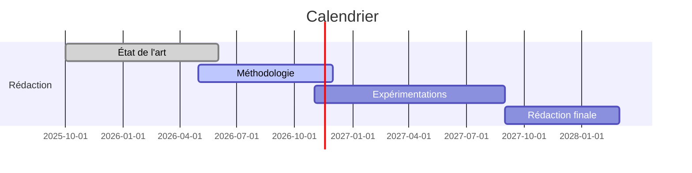

# Plan de thèse

**Sujet :** détection automatique de la fraude transactionnelle dans les systèmes de paiement mobile informels, par apprentissage profond explicable.

1. Introduction
2. [[Ch2 - État de l'art]]
3. Contexte UEMOA et [[Mobile money]]
4. [[Ch4 - Méthodologie]]
5. Expérimentations
6. Conclusion
